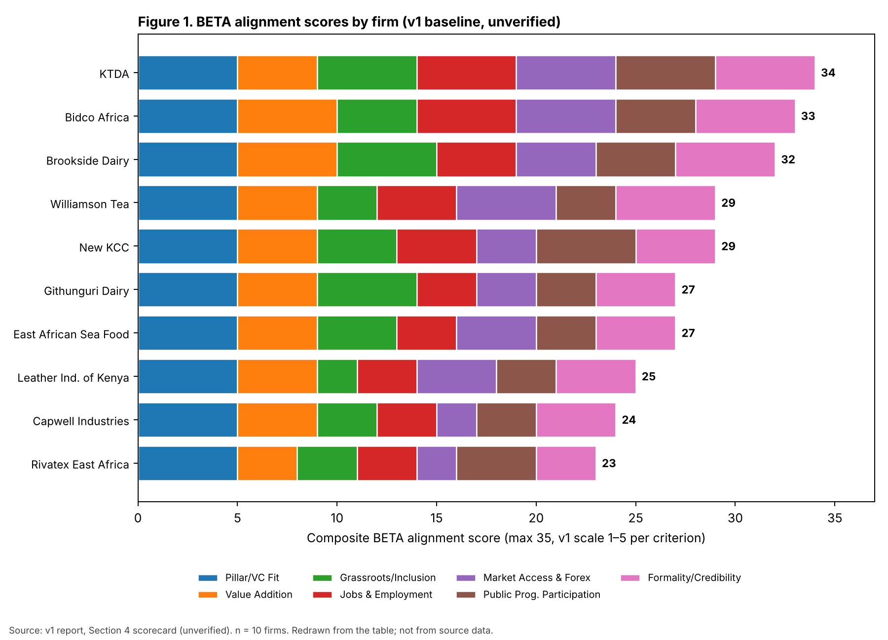
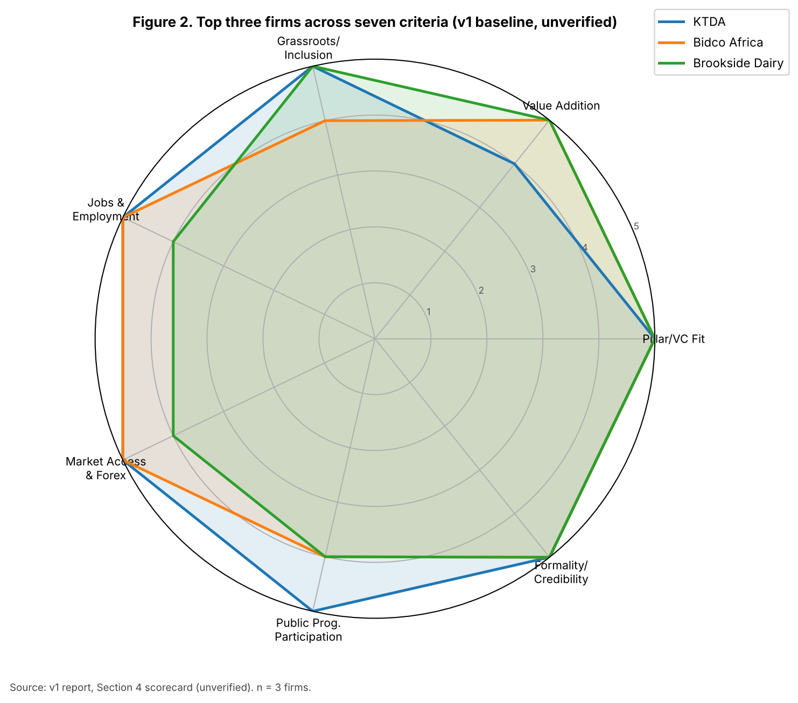

# Kenya Manufacturing Firms Assessment Against BETA Priority Value Chains and Inclusive Growth Criteria

## 1. Executive Summary

Across Kenya's seven BETA priority value chains, ten manufacturing firms were identified, scored against a 7-criterion alignment framework, and ranked into three strategic tiers. Three Tier 1 anchor firms, KTDA (tea, 34/35), Bidco Africa (edible oils, 33/35), and Brookside Dairy (dairy, 32/35), emerge as the strongest candidates for BETA-aligned engagement, each combining deep smallholder integration, significant employment, proven export performance, and robust formal governance. KTDA's cooperative model, linking roughly 600,000 farmers to 70 processing factories and generating approximately KES 160–170 billion in annual tea export earnings, represents the benchmark for inclusive value addition. Bidco Africa anchors the edible oils chain with over 5,000 employees, multi-country manufacturing, and a suite of international certifications (ISO, FSSC 22000, Halal), directly addressing Kenya's estimated KES 80 billion annual edible oil import bill. Brookside Dairy's network of approximately 200,000 smallholder suppliers, reinforced by Danone's ~40% equity stake, illustrates how foreign investment can coexist with grassroots supply chain linkages.

The most actionable finding is the stark disparity in BETA readiness across value chains. Tea and dairy benefit from mature cooperative structures and established export markets that naturally align with inclusive growth objectives, while the leather, rice, cotton, and blue economy chains score materially lower (23–27/35) due to weak upstream supply organization, underutilised processing capacity, and limited export reach. Tier 3 firms such as Rivatex East Africa and Capwell Industries require targeted public investment in raw material supply and certification infrastructure before they can match the alignment levels of top performers. For investors and development partners, Tier 1 firms offer the lowest-risk entry points, whereas Tier 2 and Tier 3 firms, particularly East African Sea Food (blue economy) and Leather Industries of Kenya, present catalytic opportunities where modest interventions in supply chain formalization and international certification could unlock disproportionate inclusive growth gains.

## 2. Introduction: BETA Framework and Assessment Methodology

Kenya's Bottom-Up Economic Transformation Agenda (BETA) represents a paradigm shift in national economic policy, placing grassroots value creation at the centre of industrial strategy. The Agricultural Transformation and Inclusive Growth pillar, one of five BETA pillars alongside the MSME Economy, Housing and Settlement, Healthcare, and Digital Superhighway and Creative Economy, prioritises seven value chains: dairy, edible oils, tea, leather, rice, cotton, and the blue economy. The overarching goal is to increase local value addition, reduce import dependence, and create employment at the grassroots level.

This report identifies and evaluates ten Kenya-based manufacturing firms operating across all seven BETA priority value chains, applying a structured 7-criterion alignment framework. The criteria are: (1) pillar and value-chain fit, (2) value addition beyond primary production, (3) grassroots and inclusion linkages, (4) jobs and local employment generation, (5) market access and foreign exchange contribution, (6) public programme participation, and (7) formality and credibility. Each criterion is scored on a 1–5 scale, yielding a maximum composite score of 35. Firms are considered BETA-aligned when they operate in a priority value chain, demonstrate measurable value addition, create employment at the county level, participate in registered public programmes, maintain formal registration and tax compliance, and contribute to import substitution or export earnings.

Entity verification draws on publicly accessible sources including the eCitizen Business Registration Service (BRS), KRA iTax PIN Checker, the Companies Registry, KEBS certification databases, and Nairobi Securities Exchange (NSE) filings. The credibility hierarchy runs from company registration through KRA compliance, KEBS product certification, sector-specific licences, and international certifications such as ISO and FSSC 22000.

## 3. Firm Profiles Across BETA Priority Value Chains

**Dairy Value Chain.** Three firms anchor Kenya's dairy processing sector. Brookside Dairy, the country's largest private processor, sources milk from approximately 200,000 smallholder farmers through an extensive network of collection centres and produces UHT milk, yogurt, butter, cheese, cream, and powder. A strategic equity stake of roughly 40% held by Danone provides both capital and international market expertise. New KCC, the state-owned cooperative processor, sources from over 100,000 farmers through affiliated cooperatives and produces UHT milk, powder, butter, ghee, and cheese. Githunguri Dairy, trading under the Fresha brand, is a farmer-owned cooperative with approximately 28,000 member farmers in Kiambu County, producing fresh milk, yogurt, butter, ghee, and cream.

**Edible Oils Value Chain.** Bidco Africa stands as the dominant BETA-aligned manufacturer in this chain, employing over 5,000 people and producing cooking oils (Elianto, Soya Gold), margarine (Kimbo), soaps, and personal care products. Bidco sources sunflower and soybean from contracted smallholders in Kenya, Uganda, and Tanzania, and operates manufacturing plants across all three countries. The firm exports to more than 15 African countries and holds ISO 9001, ISO 14001, FSSC 22000, Halal, and KEBS Diamond Mark certifications.

**Tea Value Chain.** The Kenya Tea Development Agency (KTDA) manages approximately 70 factories processing output from roughly 600,000 smallholder farmers, accounting for about 60% of national tea output. KTDA Holdings is listed on the NSE, providing formal governance and public financial reporting. Williamson Tea Kenya operates an integrated estate model encompassing growing, CTC and orthodox processing, packaging, and export, employing between 7,000 and 10,000 people and holding Fairtrade and Rainforest Alliance certifications.

**Leather Value Chain.** Leather Industries of Kenya (LIK) is one of East Africa's largest tanneries, processing raw hides into wet-blue, crust, and finished leather for export to Europe and Asia. The firm employs an estimated 500–800 people directly and benefits from AGOA eligibility for duty-free access to the US market.

**Rice Value Chain.** Capwell Industries operates a modern milling and packaging facility in Nairobi's industrial area, processing rice, maize, and wheat into multiple branded consumer and institutional products. The firm holds the KEBS Diamond Mark and is a KAM member.

**Cotton and Textiles Value Chain.** Rivatex East Africa, a state-revived mill operating in partnership with Moi University, undertakes spinning, weaving, dyeing, and finishing of fabrics. The mill supplies school uniforms and Kenya Defence Forces fabrics, though capacity remains underutilised.

**Blue Economy Value Chain.** East African Sea Food Ltd operates cold chain infrastructure, filleting, freezing, and export-grade packaging facilities in Mombasa. The firm holds EU-approved export certifications including HACCP and EU health marks, enabling access to European and Middle Eastern markets.

## 4. BETA Alignment Scorecard: 7-Criterion Evaluation

The following table presents the composite BETA alignment scores for all ten shortlisted firms. Each criterion is scored on a 1–5 scale based on publicly available evidence.

| Firm | Pillar/VC Fit | Value Addition | Grassroots/Inclusion | Jobs & Employment | Market Access & Forex | Public Prog. Participation | Formality/Credibility | Total (max 35) |
|---|---|---|---|---|---|---|---|---|
| KTDA | 5 | 4 | 5 | 5 | 5 | 5 | 5 | **34** |
| Bidco Africa | 5 | 5 | 4 | 5 | 5 | 4 | 5 | **33** |
| Brookside Dairy | 5 | 5 | 5 | 4 | 4 | 4 | 5 | **32** |
| Williamson Tea | 5 | 4 | 3 | 4 | 5 | 3 | 5 | **29** |
| New KCC | 5 | 4 | 4 | 4 | 3 | 5 | 4 | **29** |
| Githunguri Dairy | 5 | 4 | 5 | 3 | 3 | 3 | 4 | **27** |
| East African Sea Food | 5 | 4 | 4 | 3 | 4 | 3 | 4 | **27** |
| Leather Industries of Kenya | 5 | 4 | 2 | 3 | 4 | 3 | 4 | **25** |
| Capwell Industries | 5 | 4 | 3 | 3 | 2 | 3 | 4 | **24** |
| Rivatex East Africa | 5 | 3 | 3 | 3 | 2 | 4 | 3 | **23** |

*Table: BETA Alignment Composite Scores for 10 Kenya-Based Manufacturing Firms*

*Figure 1: BETA Alignment Scores. Redrawn from the Section 4 table (unverified v1 data).*

**Chart Explanation.** This stacked bar chart visualises the composite BETA alignment scores for all ten shortlisted firms, broken down by the seven evaluation criteria. KTDA leads with a score of 34 out of 35, reflecting its unmatched grassroots integration with approximately 600,000 smallholder farmers, substantial employment generation exceeding 100,000 positions, and tea exports valued at approximately KES 160–170 billion annually. Bidco Africa (33) and Brookside Dairy (32) follow closely, distinguished by their diversified value addition and extensive smallholder networks respectively.

**Scoring Rationale for Top Performers.** KTDA earns the highest composite score primarily through its cooperative ownership model, which represents the benchmark for grassroots integration in Kenyan agro-processing. The agency's factories collectively generate the largest share of Kenya's tea export earnings, and its NSE listing ensures the highest level of formal governance and transparency. Bidco Africa scores highest on value addition (5/5) due to its diversified product portfolio spanning cooking oils, margarine, soaps, and personal care, combined with multi-country manufacturing operations. Brookside Dairy matches Bidco on value addition and leads on grassroots linkages, sourcing from the largest smallholder network of any private dairy processor in Kenya.

**Scoring Rationale for Lower-Tier Firms.** Rivatex East Africa scores lowest (23/35) due to underutilised capacity, limited export activity, and its semi-dependent status as a state-revived entity. Kenya's cotton production has declined sharply from approximately 70,000 bales in the 1980s to under 30,000 in recent years, constraining Rivatex's upstream supply chain. Capwell Industries (24/35) is penalised on market access due to its primarily domestic orientation, though it maintains solid formality credentials through KEBS certification and KAM membership.

## 5. Entity Verification and Formality Assessment

All ten shortlisted firms are registered with the Registrar of Companies in Kenya and are active members of the Kenya Association of Manufacturers (KAM). Verification of registration status is possible through the eCitizen BRS portal, which confirms incorporation date, directors, share capital, and annual return filing status, while the KRA iTax PIN Checker confirms tax registration and compliance.

Three firms, KTDA Holdings, Williamson Tea Kenya, and Bata Kenya (included in the leather sector analysis), are listed on the Nairobi Securities Exchange, providing the highest tier of formal governance through mandatory public financial reporting, audited accounts, and regulatory oversight by the Capital Markets Authority. Brookside Dairy's formality is further reinforced by its foreign equity partnership with Danone, which brings international corporate governance standards.

The confidence hierarchy for entity verification follows a clear progression: BRS company registration forms the baseline, followed by KRA PIN and tax compliance, KEBS product certification (Diamond Mark), sector-specific licences such as KEPHIS for agro-products and EPZA for export zone operators, and finally international certifications including ISO, FSSC 22000, and EU health marks. Firms at the top of the shortlist (KTDA, Bidco Africa, and Brookside Dairy) satisfy all tiers of this hierarchy, while firms such as Rivatex East Africa and Capwell Industries satisfy the first three to four tiers but lack significant international certification coverage.

## 6. Internationalization Signals and Market Access

Kenya's agro-processing sector generates substantial foreign exchange, with tea alone earning approximately KES 160 billion (roughly $1.2 billion) annually, and KTDA-managed factories accounting for about 60% of national output. Williamson Tea exports to the United Kingdom, Pakistan, and Egypt, leveraging Fairtrade and Rainforest Alliance certifications to access premium market segments.

Bidco Africa demonstrates the strongest internationalization profile among the shortlisted firms, operating manufacturing plants in Kenya, Uganda, and Tanzania and exporting across 14 African countries. The firm's portfolio of international certifications (ISO 9001, ISO 14001, FSSC 22000, and Halal) positions it for continued market expansion across the continent. Brookside Dairy exports UHT milk and powder to Uganda, Tanzania, Rwanda, the DRC, and South Sudan, with the Danone equity stake providing a gateway to global dairy expertise and potential future market access beyond Africa.

In the leather sector, Kenya's leather and leather products exports were estimated at approximately $130–150 million annually as of 2023, with LIK among the top exporters. AGOA eligibility supports duty-free access to the US market, a significant advantage for finished leather goods. East African Sea Food Ltd holds EU-approved export certifications that enable access to the stringent European market, representing a notable achievement for Kenya's nascent blue economy processing sector. COMESA and EAC preferential tariffs, including the Common External Tariff and Rules of Origin frameworks, facilitate duty-free cross-border trade for certified manufacturers across the region.

## 7. Ranked Shortlist with Confidence Assessments and Strategic Implications

*Chart Explanation:* This radar chart compares the top three BETA-aligned firms across all seven criteria. KTDA dominates on grassroots integration, employment, and market access, while Bidco Africa leads on value addition and matches KTDA on jobs and market access. Brookside Dairy's strength lies in its combination of grassroots linkages and product sophistication.

*Figure 2: Top 3 Firms Radar Comparison. Redrawn from the Section 4 table (unverified v1 data).*

The final ranked shortlist, with confidence assessments and strategic tier classifications, is presented below.

| Rank | Firm | Value Chain | Score | Confidence | Tier |
|---|---|---|---|---|---|
| 1 | KTDA | Tea | 34 | High | Tier 1 |
| 2 | Bidco Africa | Edible Oils | 33 | High | Tier 1 |
| 3 | Brookside Dairy | Dairy | 32 | High | Tier 1 |
| 4 | Williamson Tea | Tea | 29 | High | Tier 2 |
| 5 | New KCC | Dairy | 29 | Medium-High | Tier 2 |
| 6 | Githunguri Dairy | Dairy | 27 | Medium | Tier 2 |
| 7 | East African Sea Food | Blue Economy | 27 | Medium | Tier 2 |
| 8 | Leather Industries of Kenya | Leather | 25 | Medium | Tier 3 |
| 9 | Capwell Industries | Rice | 24 | Medium | Tier 3 |
| 10 | Rivatex East Africa | Cotton/Textiles | 23 | Medium-Low | Tier 3 |

*Table: Final Ranked Shortlist with Confidence Assessments*

**Tier 1: Anchor Firms (Scores 32–34, High Confidence).** KTDA, Bidco Africa, and Brookside Dairy represent the strongest BETA alignment across all criteria. These firms combine deep grassroots integration, significant employment generation, proven export performance, and robust formal governance. They are natural anchor partners for BETA programme implementation, capable of scaling value-addition activities and serving as demonstration cases for inclusive industrial transformation. KTDA's cooperative model, in particular, offers a replicable template for other value chains. Bidco's multi-country operations and Brookside's foreign investment partnership with Danone illustrate how BETA-aligned firms can attract international capital while maintaining grassroots supply chain linkages.

**Tier 2: Strong Performers (Scores 27–29, Medium to High Confidence).** Williamson Tea, New KCC, Githunguri Dairy, and East African Sea Food demonstrate strong alignment on most criteria but have specific gaps. Williamson Tea's estate model limits its grassroots score compared to KTDA's cooperative structure, though its Fairtrade and Rainforest Alliance certifications signal strong sustainability credentials. New KCC benefits from direct government programme participation, including the school milk programme, but its export reach remains more limited than private-sector peers. Githunguri Dairy's farmer-owned cooperative model earns the highest grassroots score among dairy firms but its market footprint is largely domestic. East African Sea Food represents the most promising blue economy entry, with EU-approved certifications providing a credible export platform, though the sector remains nascent.

**Tier 3: Emerging or Constrained Firms (Scores 23–25, Medium to Medium-Low Confidence).** Leather Industries of Kenya, Capwell Industries, and Rivatex East Africa face structural constraints that limit their current BETA alignment scores. LIK's grassroots linkages are weak because the leather value chain's upstream segment (livestock farming) is less organised than dairy or tea cooperatives. Capwell Industries is primarily domestically oriented with limited export activity, though its modern processing capabilities and KEBS certification provide a foundation for growth. Rivatex's state-revival status and underutilised capacity reflect the broader challenges facing Kenya's cotton and textile sector, where raw material supply has declined significantly.

**Strategic Implications.** For policymakers, the assessment highlights that BETA's strongest alignment exists in the tea and dairy value chains, where cooperative structures and established export markets create natural pathways for inclusive growth. The edible oils chain, anchored by Bidco Africa, demonstrates how private-sector scale and international certification can drive import substitution, a critical BETA objective given Kenya's estimated KES 80 billion annual edible oil import bill. The leather, rice, cotton, and blue economy chains require more intensive public investment in upstream supply, processing infrastructure, and certification support to achieve comparable alignment levels. Government initiatives such as raw hide export restrictions, the Mwea Irrigation Scheme Phase II expansion, cotton revival strategies targeting 200,000 bales, and the Liwatoni Fisheries Complex development are designed to address these gaps. For investors and development partners, Tier 1 firms offer the lowest-risk entry points for BETA-aligned engagement, while Tier 2 and Tier 3 firms present opportunities for catalytic investment that could unlock significant inclusive growth potential in underserved value chains.
